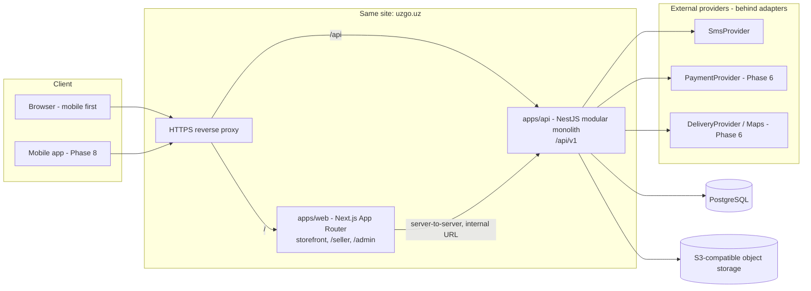
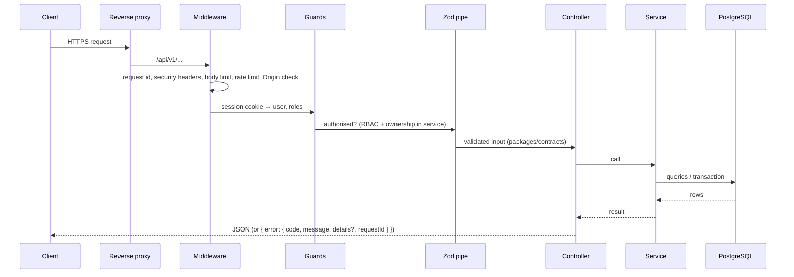

# ARCHITECTURE

## Style

**Modular monolith.** One NestJS API process and one Next.js web process, one
PostgreSQL database. Modules have explicit boundaries and talk through
services, never through each other's tables. Split into services only if a
measured need appears (ADR required). See `decisions/0001-modular-monolith.md`.

## Components

## Repository layout

See SPEC §5. Folders are created only by the phase that needs them.

- `apps/web` — Next.js. Storefront plus `/seller` and `/admin` route groups with
  their own layouts and **server-side** guards. Never imports Prisma.
- `apps/api` — NestJS. Owns `apps/api/prisma` (the only schema, migrations, seed).
- `packages/contracts` — Zod schemas + inferred types used by web and API.
- `packages/config` — shared tsconfig, ESLint, Prettier.
- `packages/ui` — design tokens and shared components (Phase 2).

## Backend modules

| Module            | Responsibility                                                                                          | Phase     |
| ----------------- | ------------------------------------------------------------------------------------------------------- | --------- |
| config            | Zod-validated env; fail fast                                                                            | 1         |
| health            | `/health/live`, `/health/ready` (DB)                                                                    | 1         |
| logging           | Structured JSON logs, request id, secret/phone masking                                                  | 1         |
| errors            | Global exception filter, standard error shape                                                           | 1         |
| geo               | Regions and districts reference data                                                                    | 3         |
| users             | User profile, phone, locale, soft delete                                                                | 3         |
| auth              | OTP request/verify, sessions, logout/logout-all, staff TOTP                                             | 3         |
| access            | Roles, store memberships, guards, ownership checks                                                      | 3         |
| audit             | Append-only audit log of sensitive actions                                                              | 3         |
| catalog           | Categories tree, attributes, multilingual content                                                       | 4         |
| stores            | Seller storefronts, members                                                                             | 4         |
| products          | Products, variants (SKU), images, fiscal fields, status                                                 | 4         |
| media             | `StorageAdapter` (dev: local disk; prod: S3-compatible)                                                 | 4         |
| inventory         | Stock per variant, reservations, expiry job                                                             | 4         |
| search            | PostgreSQL FTS + Uzbek apostrophe and Latin/Cyrillic normalisation                                      | 4         |
| cart              | User and guest carts, merge at login                                                                    | 4         |
| checkout / orders | Server-side pricing, idempotent order creation, split into `SellerOrder`s, state machines, `OrderEvent` | 4         |
| seller            | Onboarding, product and order management for sellers                                                    | 5         |
| moderation        | Product/store review queue                                                                              | 5         |
| admin             | Platform management                                                                                     | 5         |
| payments          | `PaymentProvider` adapters, verified callbacks, refunds                                                 | 6         |
| fiscal            | MXIK/IKPU, package code, VAT data for receipts                                                          | 6         |
| delivery          | Zones, pickup points, tracking, `DeliveryProvider`                                                      | 6         |
| notifications     | SMS/other messages via adapters                                                                         | 6         |
| ledger            | `LedgerEntry`, commission, `Payout`                                                                     | 6         |
| reviews, promo    | Ratings, promo codes                                                                                    | after MVP |

Rules: controllers are thin; business logic in services; DB access only inside
the owning module; anything atomic runs in a transaction.

## Web ↔ API topology

- The browser calls the API **on the same site** under `/api` (Next.js rewrite
  in development, reverse proxy in production). Auth cookie stays first-party;
  CORS is an allow-list, not a wildcard. See `decisions/0007-same-site-api.md`.
- Next.js server components call the API server-to-server via an internal base
  URL (env `API_INTERNAL_URL`) and forward the session cookie.
- API prefix `/api/v1`. OpenAPI at `/api/docs` (off in production unless enabled).

## Request lifecycle (API)

## Adapters (external providers)

Every external integration sits behind an interface in the API, with a clearly
named development implementation that can never run in production:

| Interface          | Dev implementation                                        | Real candidates (decided later)              |
| ------------------ | --------------------------------------------------------- | -------------------------------------------- |
| `SmsProvider`      | `DevSmsProvider` (logs code, `NODE_ENV=development` only) | Local SMS gateways — owner decides           |
| `StorageAdapter`   | `DevLocalDiskStorage`                                     | S3-compatible storage, ideally in Uzbekistan |
| `PaymentProvider`  | `FakePaymentProvider` (tests only)                        | Local providers — Phase 6 research           |
| `DeliveryProvider` | `FakeDeliveryProvider`                                    | Phase 6                                      |

Selection is by env variable; the app fails at startup if a dev/fake adapter is
configured in production.

## Background jobs

Initially in-process scheduled jobs in the API (e.g. releasing expired stock
reservations), written to be safe if run twice. A queue (Redis) is added only
via ADR when multiple instances or heavy jobs require it.

## Configuration

12-factor: all configuration via environment variables validated with Zod at
startup. `.env.example` contains placeholders only. Code is host-agnostic and
buildable as Docker images.

## Quality gate

GitHub Actions CI (format, lint, typecheck, migrate, test, build with a
PostgreSQL service) is the source of truth. See `decisions/0008-ci-source-of-truth.md`.
