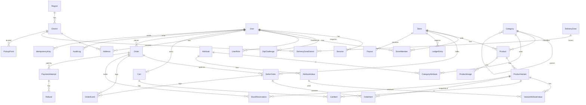
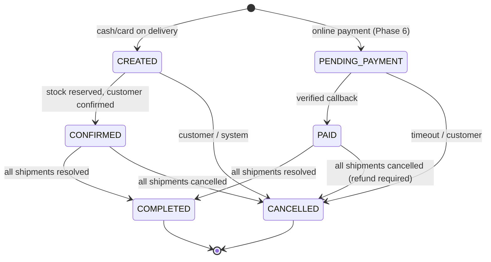
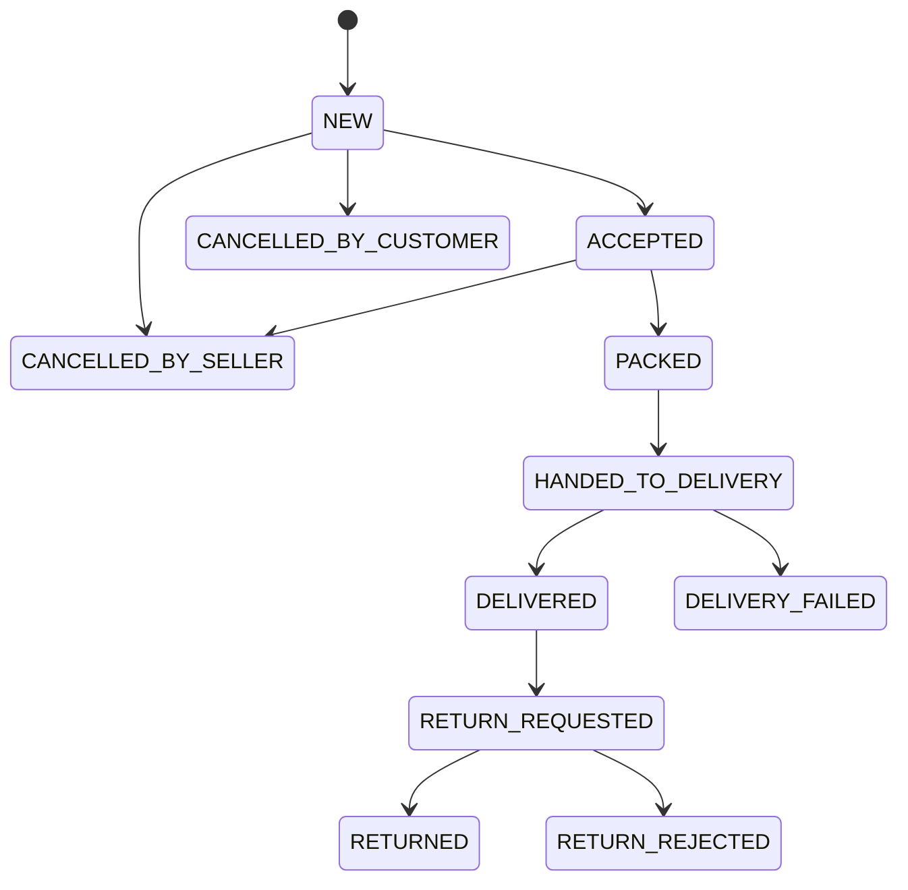

# DATABASE (draft — Phase 0)

PostgreSQL + Prisma. The only schema lives in `apps/api/prisma/schema.prisma`.
This is a **draft**: models are created in Phases 3–6 and may be refined by ADR.

## Conventions

| Topic             | Rule                                                                                                                                                                                             |
| ----------------- | ------------------------------------------------------------------------------------------------------------------------------------------------------------------------------------------------ |
| IDs               | UUID v7 primary keys (time-ordered, index friendly). Human-readable order numbers separately: `UZ-2026-000123` (per-year sequence).                                                              |
| Money             | `BigInt` **tiyin** (1 soʻm = 100 tiyin). Never floats. `CHECK (amount >= 0)` where negative is meaningless; signed only in ledger. Currency is UZS only. See `decisions/0005-money-in-tiyin.md`. |
| Time              | `timestamptz`, stored UTC, displayed `Asia/Tashkent`. `createdAt`, `updatedAt` on every table.                                                                                                   |
| Phones            | E.164 string (`+998901234567`), unique per user.                                                                                                                                                 |
| Localised content | `Json` column `{ "uz": "...", "ru": "..." }` validated by Zod, with fallback locale `uz`. New locales (`uz-Cyrl`, `en`) need no schema change.                                                   |
| Soft delete       | `deletedAt` on User, Store, Product. Orders, payments, ledger, audit, order events are **never** deleted.                                                                                        |
| Enums             | PostgreSQL enums via Prisma for statuses and roles.                                                                                                                                              |
| Constraints       | Foreign keys everywhere; `CHECK` for money ≥ 0, stock ≥ 0, quantity > 0. Some CHECKs are added in raw SQL inside Prisma migrations.                                                              |
| Indexes           | Every foreign key; every storefront filter/sort column; search vectors (GIN).                                                                                                                    |

## Draft ER diagram

## Implemented so far

- **Phase 3:** `Region`, `District` (seeded), `User`, `UserProfile`,
  `UserRole`, `Session`, `OtpCode`, `AuditEvent` — see
  `apps/api/prisma/schema.prisma`. Store membership arrives with stores (Phase 4/5).
  Hand-written SQL in the migration adds E.164 `CHECK`s, `attempts >= 0`,
  `expiresAt > createdAt` and the append-only trigger on `AuditEvent`.

- **Phase 4:** `Category`, `Attribute`, `AttributeValue`, `CategoryAttribute`,
  `Store`, `StoreMember`, `Product` (+ `searchText`, generated `searchVector`),
  `ProductAttributeValue`, `ProductVariant`, `VariantAttributeValue`,
  `ProductImage`, `Cart`, `CartItem`, `Order`, `SellerOrder`, `OrderItem`,
  `OrderEvent`, `IdempotencyKey`. Hand-written SQL adds money/stock/format
  `CHECK`s, `order_number_seq`, and triggers that forbid deleting orders,
  shipments and items and changing items and events.
- **Deferred:** `StockReservation` (needed for unpaid online orders) arrives with
  online payments in Phase 6. Cash-on-delivery orders decrement stock at
  checkout and restock on cancellation, failed delivery or return (ADR 0015).

## Geography reference data

`apps/api/prisma/data/geo.json`, loaded by `pnpm db:seed` (idempotent upserts):
14 top-level units (12 viloyat, Qoraqalpogʻiston Respublikasi, Toshkent shahri)
and 206 districts = 175 tumans + 31 cities of regional significance, with Uzbek
(Latin) and Russian names.

- **Source:** State Statistics Committee of the Republic of Uzbekistan, SDMX
  dataset 2.01.01.0036 "Tumanlar / Районы / Districts", updated 2025-03-26
  (https://api.siat.stat.uz/media/uploads/sdmx/sdmx_data_307.pdf), taken via the
  MIT-licensed package `uzbgeo@2.2.0` (ISO 3166-2 codes included). Not a runtime
  dependency — the data was copied once.
- Uzbek apostrophes normalised to U+02BB (oʻ, gʻ) and U+02BC (ʼ).
- Districts are ordered: cities first, then tumans alphabetically. Example
  Surxondaryo: Termiz shahri + 14 tumans.
- Admin editing and delivery coverage per district come in Phases 5–6.

## Entities (summary)

**Phase 3 — geo, users, auth, audit**

- `Region` (code, name Json, sort) · `District` (regionId, code, name Json, sort, active).
- `User` (phone unique, name?, locale, status, deletedAt).
- `UserRole` (userId, role enum: CUSTOMER, MODERATOR, ADMIN, SUPER_ADMIN).
- `Session` (userId, tokenHash unique, createdAt, lastSeenAt, expiresAt,
  revokedAt, ipHash, userAgent).
- `OtpChallenge` (phone, codeHash, expiresAt, attempts, consumedAt, ipHash).
- `StaffTotp` (userId, encrypted secret, enabledAt) — before production.
- `AuditLog` (actorId, action, entityType, entityId, before/after Json (masked), requestId, ip, createdAt). Append-only.

**Phase 4 — marketplace core**

- `Store` (slug unique, name Json, status, deletedAt) · `StoreMember` (storeId, userId, role: SELLER_OWNER | SELLER_STAFF; unique pair).
- `Category` (parentId, slug unique, name Json, sort, active).
- `Attribute` (code, name Json, type) · `AttributeValue` · `CategoryAttribute`.
- `Product` (storeId, categoryId, title Json, description Json, status, deletedAt, searchVector).
- `ProductVariant` (productId, sku — unique per store, barcode?, priceTiyin BigInt, stock Int, mxikCode?, packageCode?, vatRate?, active).
- `ProductImage` (productId, storageKey, sort, alt Json).
- `Address` (userId, districtId, line, phone, lat?, lng?).
- `Cart` / `CartItem` (variantId, quantity). Guest cart id in cookie, merged at login.
- `Order` (number unique, userId, status, paymentMethod, totals in tiyin, delivery address snapshot).
- `SellerOrder` (orderId, storeId, status, subtotal, deliveryFee).
- `OrderItem` (sellerOrderId, variantId, snapshot: title, variant label, unitPriceTiyin, quantity, storeId, fiscal codes).
- `OrderEvent` (orderId, sellerOrderId?, actorId?, from, to, reason?, createdAt).
- `StockReservation` (variantId, orderId, quantity, expiresAt, releasedAt).
- `IdempotencyKey` (userId, key, requestHash, response Json, createdAt; unique userId+key).

**Phase 6 — payments, delivery, money**

- `PaymentAttempt` (orderId, provider, externalId, amountTiyin, status, idempotencyKey, rawPayload Json without secrets).
- `Refund` (paymentAttemptId, amountTiyin, status, reason).
- `DeliveryZone`, `DeliveryZoneDistrict`, `PickupPoint` (address, coordinates, hours).
- `LedgerEntry` (storeId, type: SALE | COMMISSION | REFUND | PAYOUT | ADJUSTMENT, amountTiyin signed, sellerOrderId?, createdAt). Append-only.
- `Payout` (storeId, amountTiyin, status, period, reference).
- `CommissionRule` (categoryId? / storeId?, rateBasisPoints).

## State machines

Implemented as explicit transition tables in code and tested. Every transition
writes an `OrderEvent`.

### Order (customer-facing)

**Final states:** `COMPLETED`, `CANCELLED`. "All shipments resolved" = every
`SellerOrder` is in a final state. Returns after completion are handled at
`SellerOrder` level (and refunds in Phase 6); the `Order` stays `COMPLETED`.

### SellerOrder (shipment per store)

**Final states:** `CANCELLED_BY_SELLER`, `CANCELLED_BY_CUSTOMER`,
`DELIVERY_FAILED`, `RETURNED`, `RETURN_REJECTED`, and `DELIVERED` once the
return window (configurable, default 10 days — to verify against consumer law)
has closed. Cancellation, `DELIVERY_FAILED` and `RETURNED` put the goods back
into stock.

**Implemented (Phase 4):** the transition table lives in
`apps/api/src/orders/state-machine.ts` with the allowed actor per transition
(customer: cancel while `NEW`, request a return after `DELIVERED`; seller/admin:
fulfilment, cancellation, return decisions; system: delivery outcome). The
customer `Order` status is derived from its shipments: all cancelled →
`CANCELLED`; all resolved (delivered/failed/cancelled/return states) →
`COMPLETED`; any accepted or later → `CONFIRMED`; otherwise `CREATED`. Every
change writes an `OrderEvent`; transitions lock the shipment row and re-check the
table inside the transaction. Online-payment states (`PENDING_PAYMENT`, `PAID`)
come in Phase 6.

### Product

`DRAFT → PENDING_REVIEW → APPROVED | REJECTED`; `REJECTED → DRAFT` (edit);
any → `ARCHIVED`. Editing an `APPROVED` product's title/images/category sends it
back to `PENDING_REVIEW` (price/stock edits do not). Only `APPROVED`, not
deleted, with an active in-stock variant, from an active store is visible.

## Inventory and concurrency

- Reservation inside the order transaction using a conditional update:
  `UPDATE "ProductVariant" SET stock = stock - $n WHERE id = $id AND stock >= $n`.
  0 rows updated → out of stock → whole transaction rolls back.
- `CHECK (stock >= 0)` as a final guard.
- Unpaid reservations expire; an idempotent scheduled job releases them.
- Concurrency test with parallel requests against real PostgreSQL (Phase 4).

## Constraints and indexes to enforce

- Unique: `User.phone`, `Store.slug`, `Category.slug`, `(storeId, sku)`,
  `(userId, idempotency key)`, `Order.number`, `Session.tokenHash`,
  `(provider, externalId)` on payments, `(storeId, userId)` on members.
- CHECK: price/amount/total ≥ 0 (except signed ledger), stock ≥ 0, quantity > 0.
- Indexes: all FKs; `Product(status, categoryId)`, `Product(storeId, status)`,
  `ProductVariant(priceTiyin)`, `Order(userId, createdAt)`,
  `SellerOrder(storeId, status, createdAt)`, `Session(userId)`,
  `OtpChallenge(phone, createdAt)`, GIN on product search vector.

## Deletion and retention

| Data                                                                                | Rule                                                                                             |
| ----------------------------------------------------------------------------------- | ------------------------------------------------------------------------------------------------ |
| User                                                                                | Soft delete; personal fields anonymised on account deletion request, orders kept with snapshots. |
| Store, Product                                                                      | Soft delete; never hard-deleted while referenced by orders.                                      |
| Order, OrderItem, OrderEvent, PaymentAttempt, Refund, LedgerEntry, Payout, AuditLog | Never deleted.                                                                                   |
| Session                                                                             | Expired/revoked rows purged after 30 days.                                                       |
| OtpChallenge                                                                        | Purged after 24 hours.                                                                           |
| IdempotencyKey                                                                      | Purged after 7 days.                                                                             |

Exact legal retention periods (tax, consumer protection, personal data) are to
be verified with a lawyer — see `SECURITY.md`.
